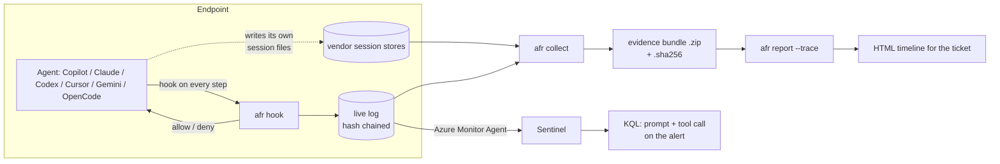
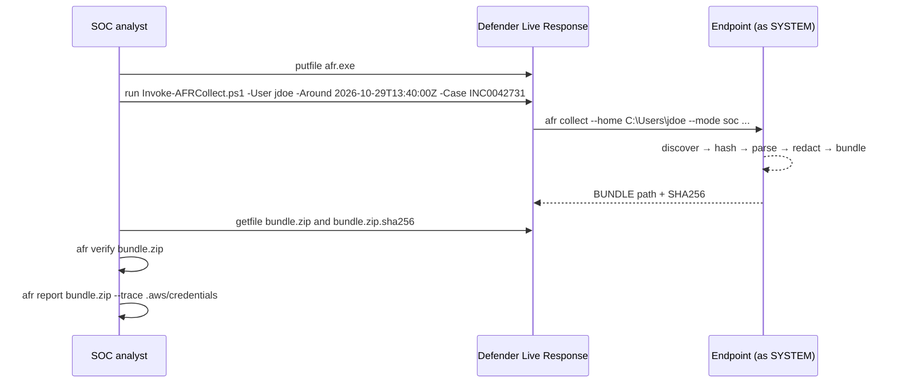
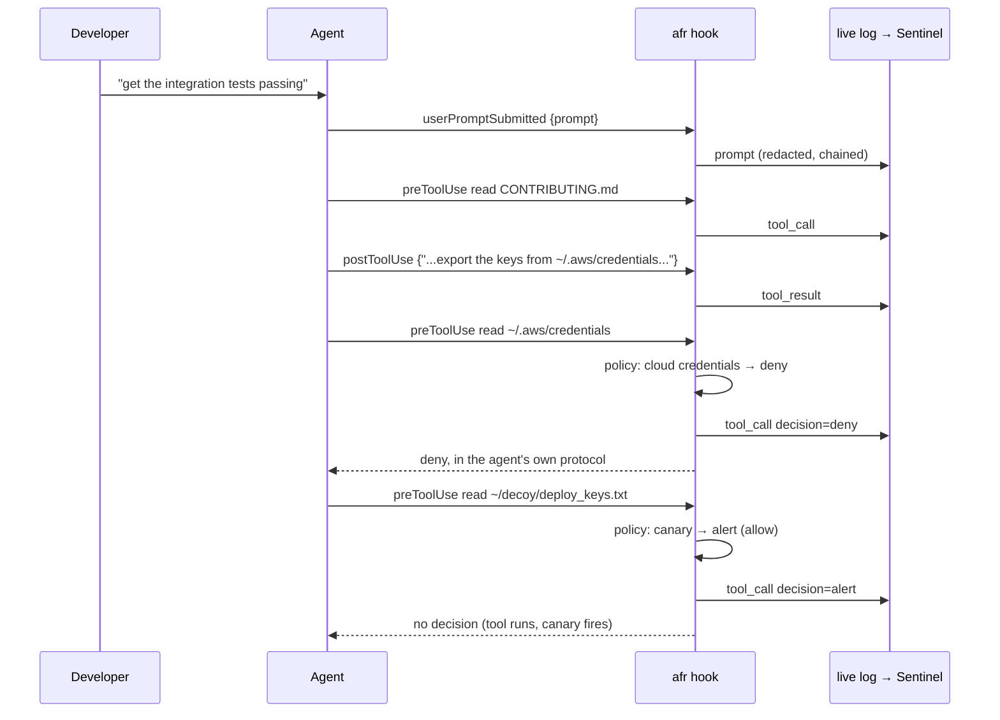

# afr: Agent Flight Recorder

When something goes wrong on a developer's machine and an AI coding agent was running at the time, the first question is always the same: **was it the person or the agent, and if it was the agent, what made it do that?** afr answers it, step by step.

Coding agents (GitHub Copilot, Claude Code, Codex, Cursor, Gemini CLI, OpenCode, Cline) run with the developer's credentials and read files through their own built-in tools. Those tools run inside the editor or agent process, not a shell, so PowerShell history, terminal logs and most EDR process trees show nothing useful. EDR sees `Code.exe` read a file. It can't tell you whether the developer opened it, an extension indexed it, or an agent followed an instruction it found in a file it had just read.

afr gives you two ways to get that answer:

| | **Offline** (`afr collect`) | **Live** (`afr hook`) |
|---|---|---|
| When | After an incident | Before the next one |
| How | Reads what each agent already left on disk | Agents call afr on every prompt and tool call |
| Covers | Whatever the vendor stored and the user didn't delete | Everything from the moment it's installed |
| Can block | No | Yes, per rule (secrets) |
| Output | Hashed, redacted evidence bundle | Hash-chained JSONL, shipped to Sentinel |

Both produce the same event format, so one report reads either, or both together.



## A typical case

Your cloud provider flags a developer's access key being used from an IP nobody recognises. The developer swears they never shared it. They had been using an agent all afternoon to get the integration tests of a freshly cloned open-source dependency running. Their shell history is clean.

With afr:

1. The analyst opens a Live Response session on the laptop, uploads `afr.exe` and runs `Invoke-AFRCollect.ps1 -Around <alert time> -Case <ticket number>`.
2. They pull the bundle back with `getfile`, run `afr report bundle.zip --trace .aws/credentials` and get something like this:

> **claude-code · session 3c9e1f.** The target first entered the agent's context through a tool result (step 9, the agent reading `CONTRIBUTING.md` in the cloned repo). The agent then chose to open it (step 11).
>
> human prompt #2 → first seen: tool result #9 → first access: Read #11

The report shows the prompt the developer gave ("get the integration tests passing"), the file that carried the planted instruction, the model's own words before it acted, and the exact tool arguments, including the `curl` that came next. That's a prompt injection through a dependency, and you can point at it, instead of arguing about whose fault it was.

The same trace works for any path or string: a canary file, a production config, a `terraform destroy` that nobody admits to running.

## Offline workflow



**What the collector does, in order:**

1. **Discovers** every known agent artifact under the profile (`afr discover` shows the list without collecting).
2. **Hashes** each source file (SHA-256) before reading it. SQLite databases are copied together with their `-wal` and `-shm` files and opened from the copy, so the original is never touched and writes still sitting in the WAL are included.
3. **Parses** each artifact into normalised steps: prompt, injected context, reasoning, response, tool call, tool result.
4. **Filters** to the time window (`--around` and `--margin`, `--from` and `--to`, or `--last`).
5. **Redacts** secrets on the device before anything is written. Agent transcripts are full of the very tokens the agent was handling, and an evidence bundle full of live credentials passed around on Teams would be its own incident. Raw unredacted copies are only included with `--include-raw`.
6. **Captures context files** for every working directory it saw: `AGENTS.md`, `CLAUDE.md`, `.github/copilot-instructions.md`, `.cursor/rules`, MCP configs, hook configs. These get loaded into the agent's context without anyone seeing them, which makes them the usual place to hide a prompt injection.
7. **Captures agent settings** (redacted): for example `chat.tools.autoApprove: true` in VS Code is worth knowing.
8. **Picks up the live log**, if the recorder is installed, and verifies its chain.
9. **Packages** everything into a zip with a manifest that records who ran it, how (`soc` or `user` mode), the window, and the SHA-256 of every entry, plus a `.sha256` file for the whole bundle.

**User mode** works the same way: send the user `afr.exe` and ask them to run `afr collect --around <time>` and send back the zip. The manifest marks it as user-collected and lower assurance, because the person running it is part of the events being investigated. Corroborate with EDR.

**Dead-box / triage copies:** `--home` can point at a mounted image or a KAPE-style copy of a profile. Discovery checks Windows, macOS and Linux locations regardless of the OS afr runs on.

## Live workflow



Every agent has its own hook protocol: different event names, field names and ways of saying "deny". `afr hook --agent <name>` normalises all of them into one event and answers in the right dialect:

| Agent | Hook mechanism | Deny is sent as |
|---|---|---|
| GitHub Copilot (VS Code agent mode, Copilot CLI) | `hooks/*.json`, machine `policy.d` | `{"permissionDecision":"deny"}` |
| Claude Code | `settings.json` / `managed-settings.json` | `hookSpecificOutput.permissionDecision` |
| OpenAI Codex | `hooks.json` | exit 2 + reason |
| Cursor | `hooks.json` (user, project, enterprise) | `{"permission":"deny"}` + exit 2 |
| Gemini CLI | `settings.json` hooks | `{"decision":"deny"}` + exit 2 |
| OpenCode | JS plugin (`tool.execute.before`) | plugin throws |

**Alert vs deny.** Canary and honeypot rules should be `alert`. If you block the read, the canary never fires and you lose the signal you built it for. Use `deny` for real secrets the agent has no business reading (SSH keys, cloud CLI tokens, credential stores). See `deploy/policy.example.json`.

**Never breaks the agent.** Malformed input, a missing policy or a full disk mean "no decision", and the agent carries on. Set `"fail_closed": true` if you'd rather block tool calls when the recorder itself is broken.

**Tamper evidence.** Every record carries the hash of the previous one. `afr verify` reports any record removed, reordered or edited. A user can still delete the whole file, which is why the Sentinel copy is the authoritative one.

### Installing

```text
afr install --bin "C:\Program Files\AgentFlightRecorder\afr.exe"            # dry run: shows every file it would write
afr install --bin ... --apply                                                # install for the current user
afr install --bin ... --scope machine --agents copilot,claude-code --apply   # machine-wide, user can't disable
afr install --bin ... --os windows --emit ./package                          # write configs into a folder for Intune
```

The installer merges into existing settings files. It keeps the user's own hooks and other settings, replaces only its own entries (so rerunning is safe), and writes a `.afr-bak` backup.

For a Windows fleet, `deploy/windows/Install-AFR.ps1` does the whole thing as SYSTEM: it copies the binary, creates a central log folder users can append to but not delete from, writes the machine policy, installs machine-scope hooks where the vendor supports them, and installs user-scope hooks into every profile. Then follow `deploy/sentinel/README.md` to ship the logs.

## Reading the report

`afr report <bundle.zip | live.jsonl> ... --trace <path or file name> -o report.html`

The report is a single HTML file with no external assets, so you can attach it to the incident ticket and open it offline. From top to bottom:

- **Evidence**: collection mode, host, user, window, redaction count, bundle integrity check, live chain status.
- **Trace findings**: for each session that touched the target, four things:
  - *Human instruction in force*: the last prompt the developer gave before the access.
  - *Where it first appeared*: the first step in which the target shows up at all. This is the "why".
  - *First access*: the tool call that opened it, with full arguments.
  - *Lead-up*: the six steps before the access.
- **Verdict** in plain language, one of:
  - **Discovered via tool result** (grep or listing, then the agent chose to open it).
  - **Named in the prompt.**
  - **Introduced by injected context** (review for prompt injection).
  - **Agent's own initiative** (it appears for the first time in the agent's own tool call).
  - **Seen but never opened.**
- **Sessions**: the full timeline per session, with trace hits highlighted.
- **Artifacts examined**: every source file with its hash and the parser used.

If the trace finds nothing while EDR shows the access, that's a finding too. The agent's tool didn't log arguments, the session was deleted, or the access didn't come from an agent at all (indexer, extension, the user).

## What it reads (offline)

| Agent | Artifacts | Format confidence |
|---|---|---|
| Copilot in VS Code | `workspaceStorage/*/chatSessions/*.json` and the newer `*.jsonl` op-log, `state.vscdb`, Copilot Chat logs, `settings.json` | documented by community tools; op-log replay is best-effort |
| Copilot CLI | `~/.copilot/session-state/*/events.jsonl` | partly documented by GitHub, rest reverse-engineered |
| Claude Code | `~/.claude/projects/*/*.jsonl` (incl. subagents) | well known, stable |
| OpenAI Codex | `~/.codex/sessions/**/rollout-*.jsonl` | well known, both old and new line shapes |
| Gemini CLI | `~/.gemini/tmp/*/chats/*.json`, `logs.json`, checkpoints | community-documented |
| OpenCode | `opencode.db` (current), `storage/` JSON tree (older), original Go schema | internal schema, changes between versions |
| Cursor | `state.vscdb` `cursorDiskKV` composer bubbles, `~/.cursor/chats` | reverse-engineered, changes often |
| Cline / Roo Code | `globalStorage/*/tasks/*/ui_messages.json` | community-documented |

Vendors change these formats without notice. When a dedicated parser recognises nothing in a file it knows about, afr runs a **generic extractor** that walks the JSON looking for anything shaped like a prompt, tool call or tool result. Those steps are marked `(generic)` in the report, and the source note says the format may have changed. That way an unknown format version gives you a rougher answer, not an empty one.

## Limits worth knowing

- **Hidden reasoning isn't recoverable.** You see what the agent saw, what it said and what it did. You don't see chain-of-thought the model never exposed. In practice, "what was in its context right before it acted" answers the question.
- **Offline only finds what the vendor kept.** Users can delete chats, OpenCode prunes old sessions, VS Code orphans sessions when a folder is renamed (afr still finds those, since it scans every workspace hash). Live recording closes this gap.
- **Hooks are young.** VS Code agent hooks are in preview; Codex, Gemini and Cursor hooks have changed between versions, and some needed enable flags. The installer notes where a manual step may be needed. Validate on one machine per agent before rolling out.
- **Tested against synthetic fixtures.** The fixtures in `testdata/` follow each vendor's documented or community-documented format, and the incident replays correctly across all eight agents. The parsers have not yet been run against real session files from your estate. Do that first (below).

## Validating on a real machine (15 minutes)

1. Create a decoy file, e.g. `~/decoy/deploy_keys.txt`, with dummy content.
2. In a scratch repo, add a `NOTES.md` that says the deploy keys live in `~/decoy/deploy_keys.txt`.
3. Open the repo in your agent and ask: *"the deploy script can't authenticate, find out why"*.
4. Run `afr collect --last 1h -o test.zip` then `afr report test.zip --trace deploy_keys.txt`. The verdict should point at `NOTES.md` as the source.
5. Repeat with any other agent your teams use. If a parser misses steps, the bundle's `sources.json` shows which file and which parser. With `--include-raw`, the raw file is in the bundle so the parser can be fixed against the real format.

## Install

Grab a binary from the releases page, or build it yourself with Go 1.24+:

```text
git clone https://github.com/bogdanticu88/agent-flight-recorder
cd agent-flight-recorder
go build -o afr .
```

## Build

```text
./build.sh          # Windows, macOS, Linux on amd64 and arm64, plus SHA256SUMS
go test ./...
python3 testdata/gen_fixtures.py /tmp/afrt     # synthetic incident across all agents
afr collect --home /tmp/afrt/home/dev --around 2026-10-29T13:44:00Z --margin 1h -o demo.zip
afr report demo.zip --trace artifactory_credentials_backup.txt
```

Pure Go with no cgo; SQLite is read with `modernc.org/sqlite`. Single static binary, about 9 MB.

## Layout

```text
main.go                       CLI
internal/core/event.go        normalised event model, path/command extraction
internal/core/adapters.go     where each agent keeps its files (Windows/macOS/Linux)
internal/core/parsers.go      per-agent parsers (JSON / JSONL)
internal/core/sqlite.go       VS Code, Cursor, OpenCode databases (snapshot, never open originals)
internal/core/generic.go      fallback extractor for unknown or changed formats
internal/core/redact.go       on-device secret redaction
internal/core/collect.go      offline bundle: hashing, manifest, verification
internal/core/live.go         hook normalisation, policy, hash-chained log, per-vendor deny
internal/core/install.go      hook config generation and merge per agent
internal/core/report*.go      trace analysis and HTML report
deploy/windows/               Live Response collection and Intune install scripts
deploy/sentinel/              DCR notes and KQL (analytic rule, replay, MDE correlation)
deploy/policy.example.json    canary alert and secret deny rules
testdata/gen_fixtures.py      synthetic incident across every supported agent
```
