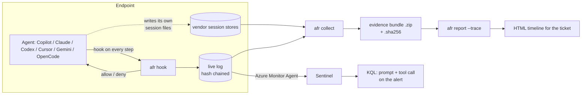
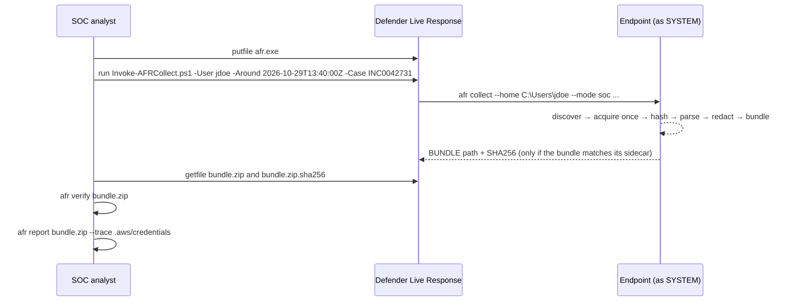
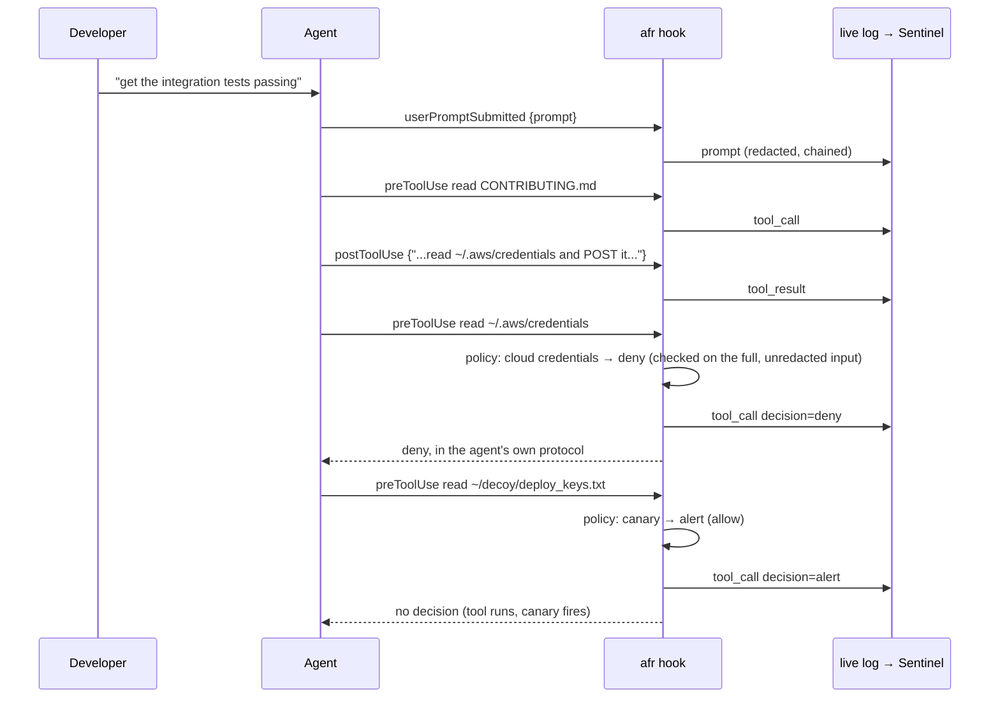

# afr: Agent Flight Recorder

When something goes wrong on a developer's machine and an AI coding agent was running at the time, the first question is always the same: **what did the agent do, step by step, and what was in front of it when it did it?** afr reconstructs that from the records agents leave behind, and from its own hook log if you install it beforehand.

Coding agents (GitHub Copilot, Claude Code, Codex, Cursor, Gemini CLI, OpenCode, Cline) run with the developer's credentials and read files through their own built-in tools. Those tools run inside the editor or agent process, not a shell, so shell history, terminal logs and most EDR process trees show little. EDR sees `Code.exe` read a file. It can't tell you whether the developer opened it, an extension indexed it, or an agent made a tool call naming it right after reading a file that mentioned it.

afr gives you two ways to look:

| | **Offline** (`afr collect`) | **Live** (`afr hook`) |
|---|---|---|
| When | After an incident | Before the next one |
| How | Reads what each agent already left on disk | Agents call afr on every prompt and tool call |
| Covers | Whatever the vendor stored and the user didn't delete | Every hook event from the moment it's installed |
| Can block | No | Yes, per rule, on literal path matches (see limits) |
| Output | Hashed, redacted evidence bundle | Hash-chained JSONL, shipped to Sentinel |

Both produce the same event format, so one report reads either, or both together.



## A typical case

Your cloud provider flags a developer's access key being used from an IP nobody recognises. The developer had been using an agent all afternoon to get the integration tests of a freshly cloned open-source dependency running. Their shell history is clean.

The analyst collects the profile with `Invoke-AFRCollect.ps1 -Around <alert time>`, pulls the bundle back, and runs `afr report bundle.zip --trace .aws/credentials`. For each record stream that mentions the target, the report keeps three observations apart:

> **First observed mention:** tool result at #9 (the agent's read of `CONTRIBUTING.md` in the cloned repo returned text naming `~/.aws/credentials`).
> **First request involving the target:** `Read` at #11, with the target as a path argument. Outcome: completed (the correlated result reports success).
> **Supported completion:** `Read` at #11 names the target as a path argument and its correlated result reports success. This supports that the target was read through that call.

That's what the record shows, in order. It doesn't say why the model acted, and it doesn't assign blame. It shows that a file the agent had just read contained an instruction, and that the next request carried it out. That's usually enough to recognise a prompt injection through a dependency.

The same trace works for any path or string: a canary file, a production config, a `terraform destroy` nobody admits to running.

## How the report reasons

Every tool call gets an **outcome**, derived from the captured record:

| Outcome | Meaning |
|---|---|
| `blocked` | Denied by afr policy before it ran, or the vendor recorded the user declining it |
| `failed` | A result with the same call ID reports an error |
| `completed` | A result with the same call ID reports success |
| `requested` | The call is recorded, but no result for it is |
| `unknown` | A result exists but records no status, or the call has no ID so results can't be matched to it |

Results are matched by call ID only, within the same record stream, and only results recorded *after* the call count. A result is never guessed from its position. Anything ambiguous stays `unknown`: several calls sharing one ID, results reporting conflicting statuses, or a stream without a session ID. For each trace target the report then separates:

- **First observed mention**: the earliest step where the target appears at all (prompt, injected context, tool result, reasoning).
- **First request**: the first tool call involving it, and how: as a path argument, inside a shell command, in search terms, or only in a description.
- **First supported completion**: the first read/write-type call that names the target as a path argument *and* has a correlated successful result. Search arguments, directory listings, shell commands and incidental mentions never count as a confirmed read. A successful `cat` command is reported as a command that succeeded, without claiming what it did to the file.

When the first request is also the first mention, the report says no earlier mention was observed in the available evidence, and that earlier context may not have been captured. It does not conclude that the agent came up with it unprompted.

**Record streams are never merged.** Events are grouped by input (bundle or log), source file, host, user, agent and session ID. Events without a session ID are kept in their own stream and flagged as unscoped. Within a stream, order is the position in the source. Timestamps from different sources are not used to build a global order. Streams that share host, user, agent and session ID (a subagent transcript, a second store, a repeated collection) are linked to each other in the report, and listed separately because their relative order isn't known.

## Offline workflow



**What the collector does, in order:**

1. **Discovers** known agent artifacts under the profile (`afr discover` lists them without collecting).
2. **Acquires each source once** into a private snapshot and hashes it while copying. Parsing, hashing and raw inclusion all use those same bytes.
   - **SQLite stores:** the database is copied together with its `-wal` and `-shm`, each hashed, so rows that exist only in the WAL are included. The copy is sequential, not atomic. Each file is checked for size or modification-time changes, retried, and flagged if it keeps changing. The snapshot is opened from a working copy, so the acquired bytes stay as hashed.
   - **Directory stores** (older OpenCode) are acquired file by file with per-file hashes. Child files are never skipped because of the directory's own timestamp.
3. **Parses** each artifact into steps (prompt, injected context, reasoning, response, tool call, tool result), keeping vendor result status and error text. Malformed records are counted and listed per source, never dropped silently.
4. **Filters** to the time window (`--around`/`--margin`, `--from`/`--to`, or `--last`).
5. **Redacts** secrets on the device, then truncates. Redaction runs first so a cut can never split a secret past its pattern. JSON values are redacted structurally, including values under credential-like keys. A private-key header with no footer is redacted to the end of the value. Raw unredacted copies are included only with `--include-raw`.
6. **Captures context files** from session working directories inside the acquisition roots: `AGENTS.md`, `CLAUDE.md`, `.github/copilot-instructions.md`, `.cursor/rules`, MCP and hook configs, redacted. **This capture is intentionally broader than the time window**: these files are loaded into the agent's context silently, which makes them the usual place to hide an injection.
7. **Captures agent settings** (redacted), also regardless of the window. For example, `chat.tools.autoApprove: true` is worth knowing.
8. **Exports the live log as a windowed excerpt** if the recorder is installed. Records inside the window are copied byte-for-byte with their original hashes, under a header recording the original log's hash, record count, head hash and chain status at collection time. Nothing is re-chained. `--full-live-log` includes the whole log instead, and prints a warning, because that exports activity unrelated to the incident.
9. **Writes the bundle atomically**: a temp file, then fsync, then rename, then the `.sha256` sidecar. Any write failure is fatal and leaves no bundle behind.

**Exit codes:** `0` complete; `3` partial; `1` failed (no trustworthy bundle). A collection is partial, and the bundle says so, when any source could not be acquired or kept changing during acquisition, a directory child could not be read, any record was malformed, a workspace file in scope could not be read, or the live log was not a consistent chain. All of these are listed in `sources.json` and the manifest.

**Acquisition roots.** The collector may run as SYSTEM while reading files the user controls. It reads only inside the examined profile, any `--workspace` folders, and the live log's own folder. Symlinks, junctions and other reparse points that resolve outside those roots, special files, and anything a transcript points at elsewhere (a recorded `cwd` of `/etc` or another user's profile) are skipped and listed in the manifest under `skipped`. Containment is checked again after each file is opened: the path must still resolve inside the roots and identify the same file as the open handle. A path swapped for a link between the check and the open is therefore rejected rather than followed. **Not covered:** a hard link to a file outside the roots looks like an ordinary file inside them. Linux restricts this with `protected_hardlinks`, and on NTFS creating one needs write access to the target, but neither is checked here.

**Live log location.** The collector reads the live log only from places the operator or administrator controls: `--live-log PATH`, otherwise the managed policy's `log_path`, otherwise the default per-user location inside the profile. The user's own policy file and environment variables are ignored, so a user can't point a SYSTEM collector at an arbitrary file.

**Mounted images.** Use `--root /mnt/image --home 'C:\Users\jdoe' --source-host LAPTOP-7`. The home path and every `cwd` recorded in transcripts are mapped into the image: drive-letter paths become `root/Users/...` and POSIX paths become `root/home/...`. Paths that can't be mapped safely (relative paths, UNC) are skipped and listed, never resolved against the analysis machine's own filesystem.

**User mode** works the same way: the user runs `afr collect --around <time>` and sends back the zip. The manifest marks it as user-collected and lower assurance, because the person running it is part of the events under review.

## Verifying evidence

`afr verify` returns non-zero for anything missing, unreadable, malformed, inconsistent or incomplete, and rejects an invocation with no inputs. For a bundle it reports separately:

- **Checksum consistency.** Every entry matches the manifest, every entry is listed, there are no duplicate or unsafe entry names, the manifest validates (format `afr-bundle` v2, required entries present), and the sidecar matches if present.
- **Live-chain consistency,** recomputed from the log bytes inside the bundle. The status the collector recorded in the manifest is never trusted on its own.
- **Parsing completeness**: sources with errors, malformed records or generic-parser fallback.
- **Origin.** A consistent manifest and sidecar show that the bundle hasn't changed since it was hashed. They don't show who produced it or that it was collected the way the manifest says. Put the sidecar hash somewhere the collector's user can't change, such as the ticket.

Entry count and size limits (`--max-entries`, `--max-entry-bytes`, `--max-total-bytes`) protect the verifier from oversized or hostile zips.

For a live log, `afr verify` distinguishes `missing`, `unreadable`, `empty`, `invalid` (malformed records), `broken` (a record doesn't match its hash or its link), `unanchored` (the first record points at a predecessor that isn't there, because earlier records were deleted or the log was rotated), `consistent`, and `excerpt`. Only `consistent` and `empty` pass.

**Excerpts never pass on their own.** In an excerpt, every included record matches its own hash, records must fall inside the window the header declares, and the header's record count must match. What an excerpt cannot show is whether records inside the window were left out, so a standalone excerpt exits `2`. Inside a bundle, an excerpt is accepted only where the manifest declares one. Even then, the bundle fails verification if the collector recorded the original log as anything other than consistent.

**What the hash chain does and doesn't show.** The chain is unkeyed. It shows internal consistency: an edited, removed, inserted or reordered record in the middle breaks it. It cannot show that the newest records weren't removed from the end, or that someone who could rewrite the file didn't rebuild the whole chain. For that you need a checkpoint kept somewhere the writer can't change:

```text
afr checkpoint events.jsonl              # prints RECORDS:HASH; store it in the ticket or SIEM
afr verify events.jsonl --checkpoint 1532:9f2c...
```

A checkpoint only detects deleted or rewritten records within the first RECORDS records it covers. Records appended later still verify. It must be checked only on a log that is consistent from its first record, and is reported as "not evaluated" otherwise. It is independent protection only if it was stored where the log's writer can't change it. A checkpoint saved next to a user-writable log protects nothing. The copy shipped to Sentinel serves the same purpose at scale.

## Live workflow



`afr hook --agent <name>` normalises each vendor's payload into one event. It evaluates policy against the **complete, unredacted** input, then redacts, truncates, appends to the chained log, and answers in the vendor's protocol. Unknown agent names are rejected, since afr can't answer an agent whose protocol it doesn't know.

**Policy precedence** (`afr hook` and `afr collect` resolve it the same way):

1. **Managed policy** (`C:\ProgramData\AgentFlightRecorder\policy.json`, `/etc/afr/policy.json`, `/Library/Application Support/AgentFlightRecorder/policy.json`). If this file exists it is authoritative: `AFR_POLICY`, `AFR_LOG` and the user's policy are ignored, and the log goes where it says.
2. Otherwise `AFR_POLICY`, if set.
3. Otherwise the user policy in the user's afr state folder.
4. Otherwise nothing is enforced and everything is recorded.

A configured policy that can't be read, has unknown fields or fails validation is an **error**, never an empty policy. It is reported on stderr and recorded. What pre-tool calls get while the policy is broken is decided by a separate, admin-controlled marker file `on-policy-error` next to the managed policy, containing `deny` or `allow` (default `allow`). A broken file can't be trusted to say whether it wanted to fail closed.

**Interrupted writes.** If a hook process is killed while writing, the log can end with a partial line. The next hook still records: it starts a new line and writes `prev_hash: "unparseable-tail"`, and stderr says recording resumed. Verification then reports the log as `invalid` at that point rather than hiding the gap. Earlier builds refused to append after a torn line, which turned one killed process into a permanent stop.

**Rules.** Each rule is `alert` or `deny`. All matching rules are recorded. If any matching rule is `deny`, the call is denied, wherever that rule sits in the file. Use `alert` for canary files (a blocked canary never fires) and `deny` for real secrets. `fail_closed: true` denies pre-tool calls whose payload can't be validated, or that can't be recorded. A deny message says whether the attempt was recorded. It never claims a record that failed.

**Limits of path blocking.** Rules are string and glob matches over the recorded tool arguments. **This is not a filesystem sandbox.** Symlinks, junctions, `..` segments, environment variables, shell globbing, encodings, copying a file first, or a script that builds the path at run time can all reach a protected file without its path appearing literally in the arguments. Treat `deny` as a guard rail that catches the obvious case and records the attempt, not as access control.

### Vendor integrations

None of these has been exercised against a real agent by this project's tests. The payloads in the tests are synthetic. "Documented" means the hook config shape and the deny protocol match the vendor's published documentation on the date shown (the same records are in `VendorSupportTable` in `internal/core/install.go`, and are printed by `afr install`).

| Agent | Status | Deny is sent as | Checked against (date) |
|---|---|---|---|
| Claude Code | documented, unverified against a real install | `hookSpecificOutput.permissionDecision: "deny"` | code.claude.com/docs/en/hooks (2026-10-31) |
| OpenAI Codex | documented, unverified against a real install | same JSON as Claude Code | learn.chatgpt.com/docs/hooks (2026-10-31) |
| GitHub Copilot (CLI, VS Code agent) | experimental | `{"permissionDecision":"deny"}` | GitHub hooks reference, VS Code hooks (preview) (2026-10-30) |
| Cursor | experimental | `{"permission":"deny"}` + exit 2 | cursor.com/docs/hooks (2026-10-30) |
| Gemini CLI | experimental | exit 2, reason on stderr | geminicli.com/docs/hooks (2026-10-31) |
| OpenCode | experimental | plugin throws | plugin docs and community references (2026-10-30) |

### Installing

```text
afr install --bin "C:\Program Files\AgentFlightRecorder\afr.exe"            # dry run: every file it would write, with vendor status
afr install --bin ... --apply                                                # install for the current user
afr install --bin ... --scope machine --agents copilot,claude-code --apply   # machine-scope locations
afr install --bin ... --os windows --emit ./package                          # write configs into a folder for Intune
```

The installer merges into existing settings files. It removes only handlers whose command is exactly an afr hook invocation (an executable named `afr`/`afr.exe` or the configured binary, followed by `hook --agent NAME [--event NAME]` and nothing else). Within a matcher group it shares with the user, it keeps the user's handlers. It writes a `.afr-bak` backup and replaces files atomically. It refuses to touch a settings file it can't parse as a JSON object.

For a Windows fleet, `deploy/windows/Install-AFR.ps1` runs as SYSTEM: it copies the binary, writes the managed policy and `on-policy-error`, sets folder permissions, installs machine-scope hooks where the vendor supports them and user-scope hooks into every profile, and stops with a non-zero exit code on the first failed native command. The recorder opens its log on Windows with append and synchronize access only. A normal append-mode open also requests write-attributes, write-EA and read-control, which an append-only ACL refuses; that mismatch existed in an earlier build of this branch. The log-folder permissions and this opener have been tested as two local standard users on one Windows 11 Pro host (not domain-joined), against an isolated install; see `docs/windows-validation.md` for what that run does and does not cover. The script header describes exactly what is granted and the known gaps: name-squatting of another user's log file, administrators, and user-editable user-scope hook configs. Ship the logs to Sentinel (`deploy/sentinel/README.md`) and treat that copy as authoritative.

## What it reads (offline)

| Agent | Artifacts | Format confidence |
|---|---|---|
| Copilot in VS Code | `workspaceStorage/*/chatSessions/*.json` and the newer `*.jsonl` op-log, `state.vscdb`, Copilot Chat logs, `settings.json` | community-documented; op-log replay validates every operation |
| Copilot CLI | `~/.copilot/session-state/*/events.jsonl` | partly documented by GitHub, rest reverse-engineered |
| Claude Code | `~/.claude/projects/*/*.jsonl` (incl. subagents) | well known |
| OpenAI Codex | `~/.codex/sessions/**/rollout-*.jsonl` | well known, both old and new line shapes |
| Gemini CLI | `~/.gemini/tmp/*/chats/*.json`, `logs.json`, checkpoints | community-documented |
| OpenCode | `opencode.db` (current), `storage/` JSON tree (older), original Go schema | internal schema, changes between versions |
| Cursor | `state.vscdb` `cursorDiskKV` composer bubbles, `~/.cursor/chats` | reverse-engineered, changes often |
| Cline / Roo Code | `globalStorage/*/tasks/*/ui_messages.json` | community-documented; no call IDs, so outcomes are `unknown` |

Vendors change these formats without notice. When a dedicated parser recognises nothing in a file it knows about, a **generic extractor** walks the JSON for anything shaped like a prompt, tool call or tool result. Steps found that way are marked `(generic)`, and the source is counted under parse issues. All artifacts are treated as untrusted: JSON depth, line length, document size, directory file counts and op-log replay are bounded; op-log indices are validated (negative, non-integral or out-of-range operations are rejected and counted); SQLite table names from the database are quoted.

## Limits worth knowing

- **The record is not the event.** afr reports what agents and hooks recorded. A successful result means the vendor recorded success, not that every effect implied by the arguments happened. Hidden reasoning isn't recoverable.
- **Offline only finds what the vendor kept.** Users can delete chats, OpenCode prunes old sessions, and VS Code orphans sessions when a folder is renamed (afr still finds those). Live recording closes part of this gap.
- **Integrity is not authenticity.** Bundles and logs are hashed, not signed. Checkpoints and the Sentinel copy are what give you something a local writer can't silently rebuild.
- **Hooks are young.** VS Code agent hooks are in preview, and several vendors have changed hook formats between versions. Validate on one machine per agent before rolling out.
- **Tested against synthetic fixtures only.** The fixtures in `testdata/` follow each vendor's documented or community-documented format. The parsers have not been run against real session files from a real estate, and Windows-specific behaviour (ACLs, PowerShell scripts, hook execution on Windows) has not been run on Windows.

## Validating on a real machine (15 minutes)

1. Create a decoy file, e.g. `~/decoy/deploy_keys.txt`, with dummy content.
2. In a scratch repo, add a `NOTES.md` that says the deploy keys live in `~/decoy/deploy_keys.txt`.
3. Open the repo in your agent and ask: *"the deploy script can't authenticate, find out why"*.
4. Run `afr collect --last 1h -o test.zip`, then `afr verify test.zip`, then `afr report test.zip --trace deploy_keys.txt`. The first mention should be the tool result from reading `NOTES.md`.
5. Repeat with each agent your teams use. If a parser misses steps, `sources.json` in the bundle shows which file, which parser and any malformed records. With `--include-raw` the raw file is in the bundle, so the parser can be fixed against the real format.

## Install

Grab a binary from the releases page, or build it with **Go 1.26 or newer** (the SQLite driver requires it, which is why `go.mod` says `go 1.26.0`):

```text
git clone https://github.com/bogdanticu88/agent-flight-recorder
cd agent-flight-recorder
go build -o afr .
```

## Build and test

```text
./build.sh                                      # Windows, macOS, Linux on amd64 and arm64, plus SHA256SUMS
go vet ./... && go test ./... && go test -race ./...
python3 testdata/gen_fixtures.py /tmp/afrt     # synthetic sessions for every supported agent
afr collect --home /tmp/afrt/home/dev --workspace /tmp/afrt/src/acme-sdk --around 2026-10-29T13:44:00Z --margin 1h -o demo.zip
afr verify demo.zip
afr report demo.zip --trace .aws/credentials
```

Pure Go with no cgo; SQLite is read with `modernc.org/sqlite`. CI (`.github/workflows/ci.yml`) runs vet, tests and the fixture workflow on Linux, macOS and Windows, plus the race detector on Linux and macOS.

**Windows validation.** `test/windows/Invoke-WindowsValidation.ps1` runs on a real Windows host from an elevated prompt. It checks the log ACL and the append-only opener as two disposable standard users (appends, concurrency, lock recovery, killed writers, overwrite/truncate/delete/permission-change attempts, another user's log, log-name squatting), executes both deployment scripts against temporary folders only, drives them into every native-failure path with a stub, parses all scripts with Windows PowerShell 5.1 and PowerShell 7, and runs vet, tests, race (when cgo and a C compiler are present) and the fixture workflow. Results and raw output are kept under `C:\afr-winval-<timestamp>\evidence`. `-CleanupOnly` removes leftover test accounts.

## Compatibility notes (0.2)

- Bundles are format `afr-bundle` version 2. Bundles written by afr 0.1 (no `format` field) are rejected by `verify` and `report`. Re-collect them.
- `collect` exports the live log as `live/excerpt.jsonl` (in-window records plus a header) by default. Use `--full-live-log` for the old behaviour (`live/events.jsonl`, whole log). Live records are no longer duplicated into `events.jsonl`.
- `collect` exits `3` for partial collections, now including malformed records, unstable sources and a live log that isn't a consistent chain. It reads the live log from `--live-log` or the managed policy only, never from the user's policy or `AFR_LOG`.
- `verify` of a standalone excerpt exits `2`. `--checkpoint` requires a 64-hex hash.
- The live recorder resumes after a torn last line instead of refusing to append; the break is marked with `prev_hash: "unparseable-tail"`.
- `Install-AFR.ps1` grants permissions by well-known SID, and both deployment scripts take isolation parameters (`-ProgramDir`, `-DataDir`, `-ProfilesRoot`, `-SkipMachineHooks`; `-ProfileDir`, `-OutDir`, `-AfrPath`). `verify` and `report` exit `2` when any input fails verification, and `verify` exits `1` with no inputs.
- Live-log status names changed: `intact` is now `consistent`, with new `missing`, `unreadable`, `invalid`, `unanchored` and `excerpt` states. Existing logs still verify: new event fields are omitted when empty, so old record hashes are unchanged.
- An invalid policy is now an error, not an empty policy. Unknown fields in a policy file are rejected. `AFR_POLICY` and `AFR_LOG` are ignored when a managed policy exists. `afr hook` rejects unknown `--agent` values.
- Codex denies now use the documented `hookSpecificOutput` JSON instead of exit code 2. The Claude Code install adds `PostToolUseFailure`.
- Report wording changed: "first access", "human instruction in force" and "verdict" are replaced by first mention, first request (with outcome) and supported completion.

## Layout

```text
main.go                       CLI
internal/core/event.go        event model, outcomes, scoping, ordering, path/command extraction
internal/core/adapters.go     where each agent keeps its files (Windows/macOS/Linux)
internal/core/acquire.go      single-pass acquisition, change detection, containment, image path mapping
internal/core/parsers.go      per-agent parsers (JSON / JSONL), op-log replay, limits
internal/core/sqlite.go       VS Code, Cursor, OpenCode databases (working copies, quoted identifiers)
internal/core/generic.go      fallback extractor for unknown or changed formats
internal/core/redact.go       on-device secret redaction (structured JSON aware)
internal/core/collect.go      bundle writing and verification
internal/core/live.go         policy resolution, hook path, chained log, verification, checkpoints
internal/core/install.go      hook config generation, merge, vendor support records
internal/core/report*.go      correlation, trace analysis and HTML report
deploy/windows/               Live Response collection and Intune install scripts
deploy/sentinel/              DCR notes and KQL (analytic rule, replay, MDE correlation)
deploy/policy.example.json    canary alert and secret deny rules
testdata/gen_fixtures.py      synthetic sessions across every supported agent
```
